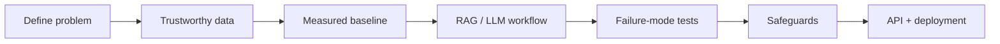

### I build AI systems people can trust—and teams can ship.

**Applied AI Engineer · PhD Researcher · Persian NLP · Trustworthy AI**

I connect research to real-world software: measurable model evaluation, evidence-grounded retrieval, and reliable AI applications.

 

 

## What I bring

| **Research mindset** | **Engineering mindset** | **Domain focus** |
|---|---|---|
| PhD candidate in Electrical Engineering — Electronics at the University of Tehran | Retrieval, evaluation, APIs, model serving, safeguards, and containerized applications | Persian NLP, document intelligence, trustworthy LLMs, and healthcare AI |

I care about systems that do more than produce a convincing demo: their outputs should be grounded, their quality measurable, and their failure modes understood.

## Selected results

| **Persian language evaluation** | **Built for reliability** |
|---|---|
| **62.69% accuracy** — Qwen2.5-14B on ParsiNLU entailment **43.00% accuracy** — Qwen2.5-14B on the Khayyam benchmark | Persian RAG assistant with retrieval-confidence checks and safe fallbacks Quality-aware PDF pipeline that selects native extraction or OCR |

## Featured projects

| Project | What it does | Technologies |
|---|---|---|
| [**Persian User RAG Chatbot**](https://github.com/ali-ebrahimii/User-RAG-ChatBot) | Generates evidence-grounded Persian answers with normalization, confidence checks, and safe fallbacks | Python · FastAPI · Qwen · vLLM · FAISS |
| [**Persian LLM Benchmark**](https://github.com/ali-ebrahimii/Test-Qwen2.5-7B-and-14B-Llama-3.1-8B-on-Khayyam-challenge-and-ParsiNLu-Entailment) | Compares open models across Persian reasoning, entailment, and sentiment tasks | Transformers · ParsiNLU · Quantization |
| [**Persian PDF Text Extraction**](https://github.com/ali-ebrahimii/Persian-PDF-Text-Extraction-Pypdf2-OCR) | Chooses native extraction or Persian/English OCR based on document text quality | PyPDF2 · Tesseract · pdf2image |
| [**Doctor's Assistant API**](https://github.com/ali-ebrahimii/ChatGPT-API-Doctor-Assistance) | Produces structured Persian clinical summaries with validation and safety constraints | FastAPI · Pydantic · Docker |

## How I approach AI engineering

## Currently exploring

- Reliable RAG and agentic workflows for Persian-language products
- Efficient evaluation and serving of multilingual open-weight models
- Structured LLM outputs and safety controls for healthcare workflows

**Core toolkit:** Python · PyTorch · TensorFlow · Transformers · FastAPI · Pydantic · vLLM · Streamlit · Django · Docker · FAISS · SQL · OCR

## Let's work together

I'm open to **Applied AI, Machine Learning, and NLP engineering roles**, as well as research collaborations—especially where Persian-language AI, document intelligence, or healthcare applications need to move from experiments to dependable products.

