### I build AI systems that are measured, grounded and deployable.

**Senior Applied AI Engineer · Persian NLP · RAG · Trustworthy AI**

I turn research into dependable software: retrieval that knows when to say *"I don't know"*, evaluations that show exactly where a model breaks, and clinical-text services with explicit safety constraints.

[Featured systems](#featured-systems) · [Architecture](#architecture-spotlight) · [Evidence](#evidence) · [Principles](#engineering-principles) · [Stack](#technical-depth) · [Work with me](#work-with-me)

 

## What I own

- **Research rigor** — PhD candidate in Electrical Engineering (Electronics) at the University of Tehran. Like-for-like zero-shot evaluation of open-weight LLMs on Persian tasks, reported honestly, including where models are no better than chance.
- **System design** — End-to-end Persian retrieval systems: normalization, intent routing, dense retrieval, confidence gating and safe fallbacks — designed for the failure case first.
- **Delivery** — Typed FastAPI services with health checks and request-ID logging, Docker/Compose packaging, and open-weight models served through vLLM.

## Featured systems

- **[Persian RAG Assistant](https://github.com/ali-ebrahimii/User-RAG-ChatBot)** — *pre-production prototype for a health-insurance platform* 
  Answers Persian questions only from approved documents. Intent routing, query expansion and dense retrieval feed a score-and-margin trust gate — weak evidence ends in a transparent fallback, never a guess. 
  `FastAPI` · `FAISS` · `multilingual-e5-large` · `Qwen2.5-7B (AWQ)` · `vLLM`

- **[Persian LLM Benchmark](https://github.com/ali-ebrahimii/Test-Qwen2.5-7B-and-14B-Llama-3.1-8B-on-Khayyam-challenge-and-ParsiNLu-Entailment)** — *zero-shot evaluation study* 
  Compares Qwen2.5-14B, Qwen2.5-7B and Llama-3.1-8B on ParsiNLU entailment, Khayyam reasoning and aspect-based sentiment with fully Persian prompts and 4-bit quantization. 
  `Transformers` · `bitsandbytes` · `ParsiNLU` · `Khayyam`

- **[Persian PDF Text Extraction](https://github.com/ali-ebrahimii/Persian-PDF-Text-Extraction-Pypdf2-OCR)** — *dataset-preparation pipeline* 
  Extracts natively first, scores the text, and falls back to 300-DPI Persian + English OCR when quality is low. Parallel batches with resumable CSV tracking. 
  `PyPDF2` · `Tesseract` · `pdf2image` · `multiprocessing`

- **[Doctor's Assistant API](https://github.com/ali-ebrahimii/ChatGPT-API-Doctor-Assistance)** — *production-oriented clinical-summary service* 
  Turns raw patient-intake JSON into a fixed-schema Persian clinical summary — validated, auto-repaired when malformed, and explicitly not a final diagnosis. 
  `FastAPI` · `Pydantic` · `OpenAI API` · `Docker`

## Architecture spotlight

**Persian RAG assistant — evidence or fallback, never a guess.**

- **A trust gate, not blind top-k.** Retrieved chunks must clear a minimum similarity score *and* a top-1/top-2 margin before the LLM sees them. Short queries are relaxed; the intent-anchor pass is held to a stricter bar.
- **Three retrieval passes, then a graceful fallback.** The question itself, an intent anchor, then a rule-based rewrite. If none is trustworthy, the user gets an honest "outside my scope" answer with a human contact instead of a hallucination.
- **Policy before retrieval.** Rule-based Persian intent routing short-circuits empty, out-of-scope and medical-advice questions before any retrieval or generation, so flagged requests never reach the model.
- **Auditable by construction.** Every response carries a typed status (`ok`, `ok_anchor`, `ok_rewrite`, `fallback`, `medical_redirect`, …) alongside `/healthz` and request-ID logging.

Working pre-production prototype built for a health-insurance platform; the public repository is a sanitized portfolio snapshot.

## Evidence

- **Entailment:** Qwen2.5-14B reaches **62.69%** on ParsiNLU, and Qwen2.5-7B lands within 1.5 points (61.19%) — a useful signal when serving cost matters.
- **Reasoning:** On the Khayyam challenge Qwen2.5-14B scores **43.00%**, and every model clears the 25% random baseline.
- **Honest reporting:** Aspect-based sentiment sat near the ~14% random baseline for all three models, so it is reported as unsolved zero-shot rather than buried.

Protocol: zero-shot, fully Persian prompts, 4-bit NF4 quantization — identical for every model. Reference lines come from the public Khayyam leaderboard as recorded in the repository; evaluation protocols may differ.

## Engineering principles

| Principle | Where it shows up |
|---|---|
| **Ground every answer** | The RAG assistant answers only from approved documents, and retrieval must clear a score-and-margin gate before generation. |
| **Measure before you scale** | One zero-shot protocol across three open-weight models, with near-chance results called out instead of hidden. |
| **Fail safe by design** | Typed response statuses, human-contact fallbacks and medical-advice redirects; the clinical API states plainly that it gives no final diagnosis. |
| **Ship the whole system** | FastAPI contracts, `/healthz`, request-ID logging, Docker/Compose packaging and resumable batch pipelines. |

## Technical depth

**Core toolkit:** Python · PyTorch · TensorFlow · Transformers · FastAPI · Pydantic · vLLM · FAISS · Docker · Streamlit · Django · scikit-learn · pandas · NumPy · SQL · Tesseract OCR

## Currently exploring

- Reliable RAG and agentic workflows for Persian-language products
- Efficient evaluation and serving of multilingual open-weight models
- Structured LLM outputs and safety controls for healthcare workflows

## Work with me

I'm open to **senior Applied AI, Machine Learning and NLP engineering roles** and to **research collaborations** — especially where Persian-language AI, document intelligence or healthcare applications need to move from experiments to dependable products.

**A strong fit if you need to…**

- ship retrieval-augmented systems that can say *"I don't know"* instead of guessing;
- evaluate open-weight LLMs for a specific language or domain, with numbers you can defend;
- turn a notebook prototype into a typed, containerized API with health checks and request tracing.

 

